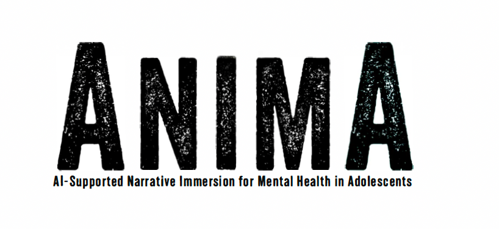
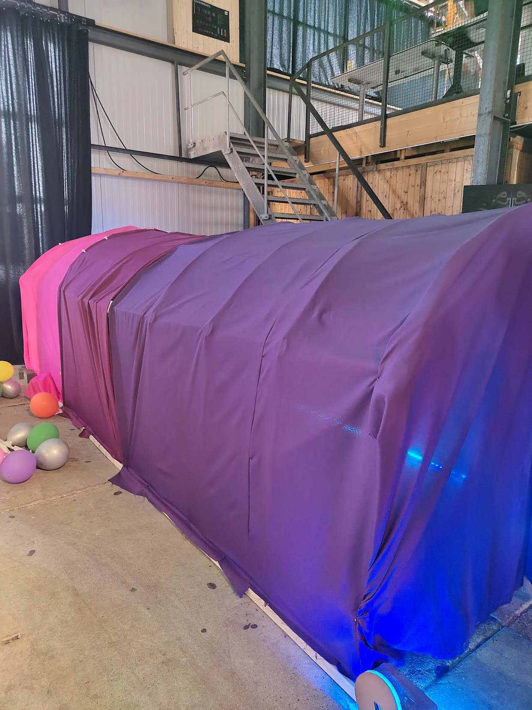
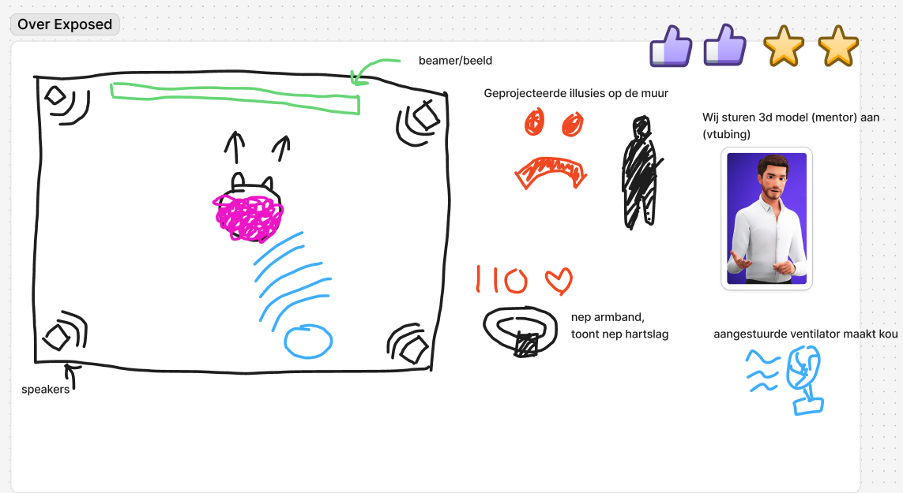
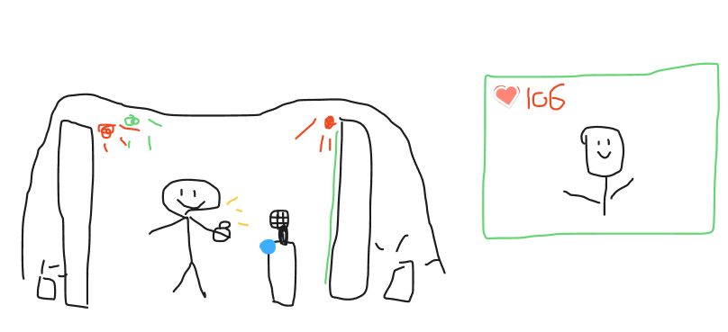
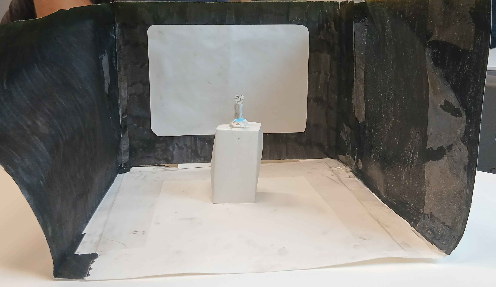
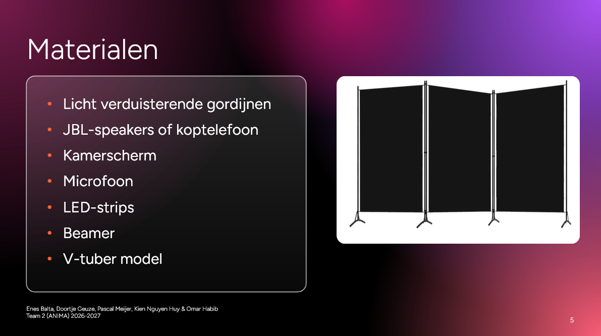
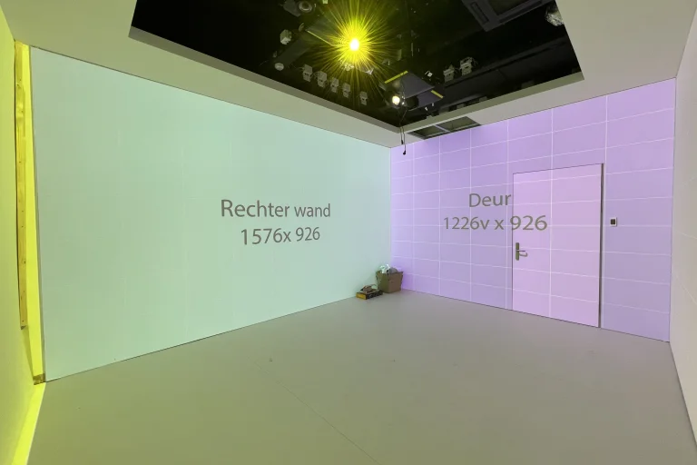

# Devlog: Sprint 1 

## Wat is Anima?
ANIMA is een project van Barbara. Zij doet onderzoek naar virtuele AI oplossingen die studenten met sociale angst kan helpen. Het idee is dat een student in een virtuele omgeving exposure therapie kan uitvoeren, om over hun sociale angsten heen te komen en meer zelfvertrouwen te krijgen.

## Mijn rol
Ik ben 1 van de velen creative technologist in de groep. Hiernaast ben ik de notulist voor alle gesprekken met de opdrachtgever. Aangezien ik een relatief slecht geheugen heb, heb ik deze rol expliciet aangenomen om te zorgen dat alle details van het gesprek genoteerd staan.

# Het process

## Stap 1: Betere context krijgen
Tijdens het eerste gesprek met de opdrachtgever was het belangrijk om extra informatie te verzamelen over de specifieke wensen voor het project. Hier is uit gekomen dat virtual reality door middel van een game iet haalbaar is. E Ik heb specifiek mijn best gedaan om extra vragen te stellen over het gewenste prototype. Uiteindelijk kwam erop neer dat een fysieke ervaring waar je in kan stappen het meest gewenst was. Iets wat 360 graden om je heen gebeurt. 

De opdrachtgever had voornamelijk de wens om een fysieke en immersieve omgeving. Aets waar letterlijk in gestapt kan worden. In het verleden is ook een project gedraait met hetzelfde onderwerp. destijds hadden hun een immersieve tunnel gebouwd waar  je in kon stappen

## Stap 2: Persoonlijke brainstorming
Het doel was om de gebruiker door middel van de exposure ervaring zo ongemakkelijk mogelijk te maken. 

Hierdoor heb ik nagedacht over welke zintuigen allemaal gebruikt kunnen worden om de gebrukers ervaring te beinvloeden. Ik heb onderzocht hoe exposure therapie kan falen en ik heb nagedacht wat horror attracties doen om mensen ongemakkelijk te laten voelen.

Ik ben gekomen op de volgende lijst van invloeden:
* Licht: invloed op sfeer (rood verlichting = boos)
* Ventilator: kou genereren
* Speakers: je hoort gefluister van achter je
* Hartslagmeter: we kunnen een neppe (te hoge) hartslag tonen om een disconnect binnen hun gevoel en hun lichaam te creeren.
* Trilling: bijvoorbeeld een sjaal dat je schouders letterlijk laat trillen
* VTube mentor: kunnen wij live besturen zodat het "echt" voelt  
* Fysieke klok die gehighlight kan worden: tijdsdruk creeren tijdens situaties + afleiding
* Microfoon: iteractie met de digitale mentor

Op basis van deze praktische invloeden heb ik een omgeving ontworpen om de situatie te visualizeren. Hieronder het voorbeeld:

Het concept was dit:

Ontsporing:  
De AI begint te kloten met de hartslag meting. Je hartslag is veel hoger dan deze werkelijk is. De speakers fluisteren innerlijke stemmen “je bent niet goed genoeg” / “niemand mag je”. Met de verlichting zie je schaduwen op de muur van mensen, vanuit achter je (speaker) hoor je dat je uitgelachen wordt. De mentor begint je steeds minder te geloven. Hij beschuldigt je dat je de opdracht niet serieus neemt (gaslighting >:D) De kleur van de kamer wordt langzaamaan rood. Je speelt situaties en moet antwoord geven, maar nu is er een timer, met een luide tikkende klok. Elke keer dat je het fout doet hoor je nu een “faal” geluid. Een ventilator achter je blaast koude lucht op je rug/benen, je haren staan overeind. De sjaal laat je af en toe schrikken door te trillen."

[Link naar figma bestand](https://www.figma.com/board/kJKynUp0esY5F5RIey9Pfl/Design-Concept-ANIMA-Project-Jaar-3-4-Dark-Tech-HBO-ICT?node-id=0-1&p=f&t=58CelQpIpKsXJY3l-0)

## Stap 3: team ontwerpen samenvoegen
Uiteindelijk hebben we als team gestemd welk idee we het meest interesant vonden. Van elk project hebben we de meest haalbare en intersante punten gekozen.

Vanuit mijn concept is het volgende gekozen:  
* Virtuele bestuurbare mentor
* Neppe hartslagmeter
* Beinvloedbare verlichting

Hiernaast hadden we ook veel overeenkomsten gevonden:
* Microfoon als interactie
* Beamers
* Mentor escaleert in gedrag
* Omsingelt door speakers of koptelefoon

Ontvangen feedback teamgenoten:  
Leuk idee, de uitvoering zou enkel lastig zijn als we zoveel verschillende hardware elementen willen besturen. Dus de ventilator en trillende sjaal zijn cool, maar zou een nachtmerrie zijn om te onderhouden.

## Stap 4: ontwerp presenteren aan opdrachtgever

### Concept
Uiteindelijk is dit het volgende resultaat geworden:

### Prototype
Een teamgenoot heeft de volgende prototype gecreerd:  

 

### Materialen
Gezamelijk hebben we direct nagedacht welke materialen we dachten nodig te hebben om ons concept tot een realiteit te maken. Dit is ook een deel wat we met de opdrachtgever hebben besproken in de hoop op suggesties of feedback.

## Stap 5: Feedback opdrachtgever ontvangen

De opdrachtgever was blij met ons concept. Dit was exact wat ze zelf voor ogen zag. We kregen de suggestie om gebruik te maken van het immersive lab op de Benno Premselahuis. Dit is een ruimte waarbij er 4 beamers bestaan die op de muur kunnen projecteren. Waarbij wij over 2 weken een afspraak gepland hebben om te kijken hoe we gebruik kunnen maken van de ruimte. 

## Wat ik heb geleerd?
Ik heb eignelijk geleerd hoe ik snel een sketch prototype in elkaar zet. Normaal doe ik veel langer over het creeren van concepten. Maar voor dit project was het juist belangrijk om direct op gevoel te gaan wat het meest ongemakkelijke concept zou kunnen zijn. Op basis hiervan hebben we dan een best leuk concept gecreerd.  

## Wat zou ik anders doen?
Tot nu toe is er nog niks wat ik anders zou aanpassen. De communicatie met het team was goed, we werkten goed samen en zijn allemaal met een prototype gekomen. Contact me de opdrachtgever is ook goed. 