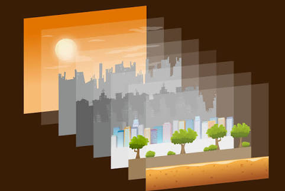
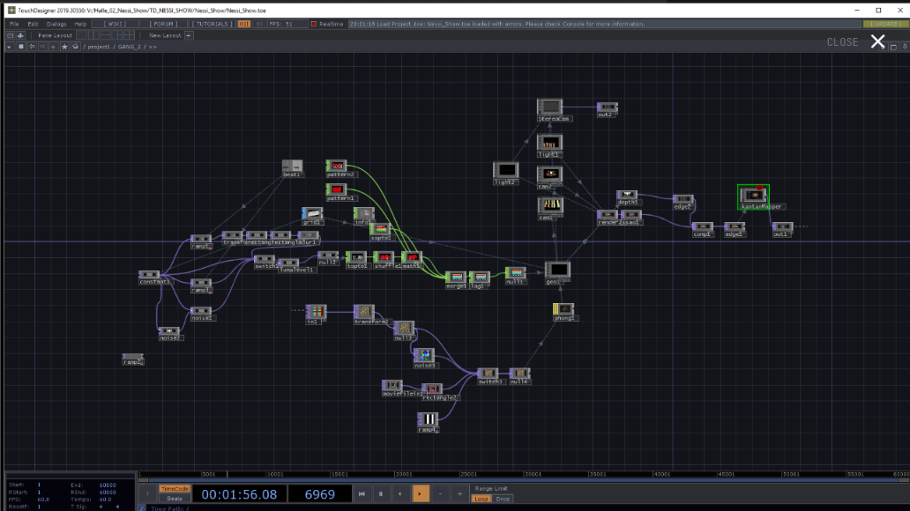
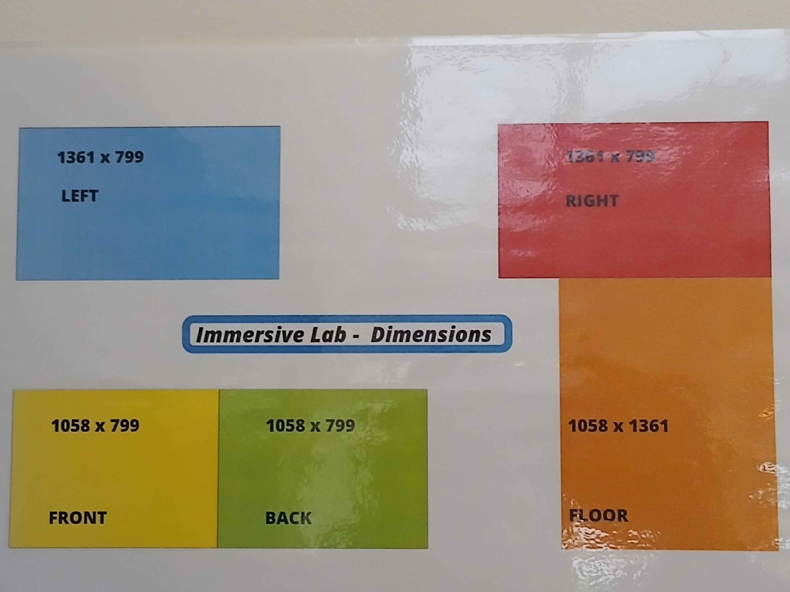
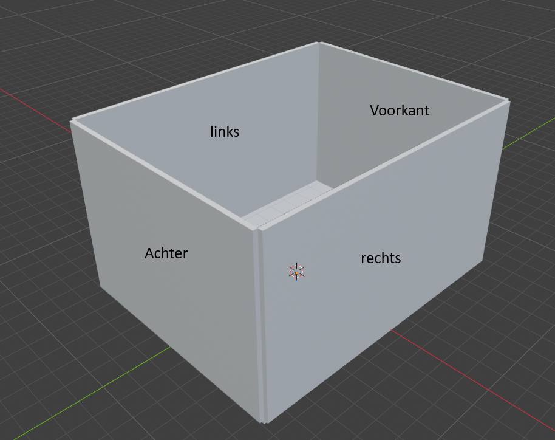
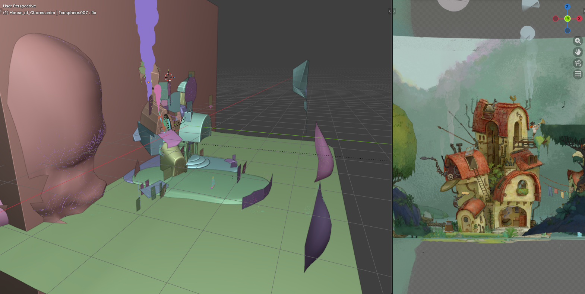
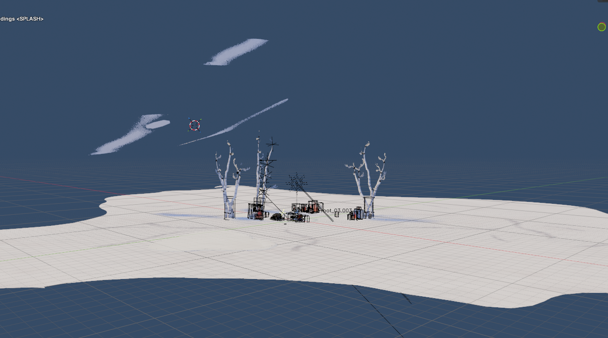
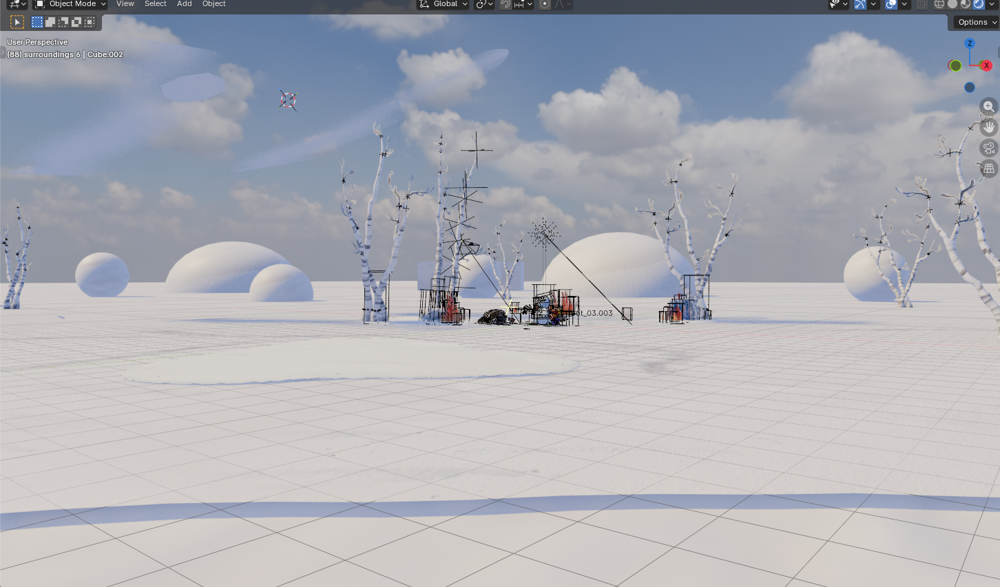
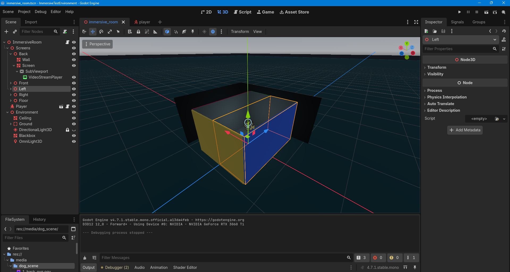

# Sprint 2
Voor de immersive lab moeten we een video/beeld bouwen voor de exposure scenario. Voor deze sprint heb ik gedacht over hoe ik dit kan doen.

Ik kwam neer op verschillende mogelijkheden:
1. 2D afbeeldingen die bewegen
2. 3D omgeving
3. TouchDesigner

## Visuele vormgeving kiezen

### 2D afbeeldingen
Ik zat te denken aan 2D parralax. Parallax is eigelijk meerdere lagen van 2D afbeeldingen die bewegen, waardoor je de illusie van diepte creert.
Na een kleine start te maken in davinci pro, ben ik hier snel mee gestopt omdat ik het eigenlijk geen leuke process vond.

### TouchDesigner
Van de docent die de immersive room had uitgelegd was touchdesigner iets wat veel studenten gebruikte om reactiviteit te bouwen. Touchdesigner is een programma waarbij je "live" beelden geneerd. Het is eigenlijk een super coole programma. Je kan een AI tracking systeem koppelen aan touchdesigner en op basis van handsignalen bepaalde effecten triggeren. Het probleem is, er is best wel een diepe learning curve om het te begrijpen. 

Omdat mijn team niet super veel interesse lijkt te hebben in het visuele ontwerp gedeelte, leek het het beste om iets te kiezen waarbij ik zelf ook gemotiveerd ben. Touchdesigner is not it. 

### 3D omgeving
Ik zat eraan te denken om in blender een 3D scene te bouwen, dit op te nemen met 5 cameras waarbij elke camera overeenkomt met 1 muur van de immersive room. En dan de opgenomen beelden op de muren te projecteren. Voor mijn skill leven en zowel interesse, zou dit de makkelijkste aanpak zijn om uit te voeren.

# 3D omgeving experiment
Het prettige van een 3D omgeving, is dat er veel bestaande resources online zijn die gebruitk kunnen worden om een omgeving te bouwen.
Doordat het 3D is krijg je direct het gevoel van diepte wat hopelijk toevoegd aan de immersiviteit van de ervaring. Opnames zouden ook redelijk makkelijk zijn voor de opdrachtgever zelf om te runnen dan een opgezette live 3D omgeving wat geprojecteerd wordt. 

## Immersive room nabouwen

De immersive lab heeft een poster voor de deur met de volgende dimensies:

- front: 1058x799px
- back: 1058x799px
- left: 1361x799px
- right: 361x799px
- floor: 1058x1361px

Ik heb geen werkelijke dimenties van de muur in meters, maar gelukkig is dat ook niet nodig. We kunnen de resolutie gebruiken om de verhouding tussen breedte en hoogte te bewaren. Dit betekend dat ik de resolutie door 100 heb gedeeld, en deze formaten heb gebruikt. 

Dit komt neer op een digitale immersive room met de formaten:
- Front: 10.58 x 7.99 meter
- Back: 10.58 x 7.99 meter
- Left: 13.61 x 7.99 meter
- Right: 13.61 x 7.99 meter

Uiteraard is de werkelijke immersive lab niet zo groot, maar dat maakt niet uit. Zolang de breedte en hoogte hetzelfde is schaalt de opgenomen video netjes naar beneden. Het belangrijkste is experimenteren en leren of het mogelijk is om naadloze videos te genereren.

Dus nu hebben we deze prachtige kamer:

## Demo omgeving bouwen
Om te testen of het zou werken wou ik graag een omgeving hebben die er relevant of mooi uitziet. 
Dus ik heb online meerdere projecten gedownload. Helaas zijn veel projecten gebroken en zijn mijn skills in Blender te ontbrekend om te weten hoe ik het kan fixen.

Voorbeeld:    
Sommige missen texturen en zien er daardoor niet goed uit (roze = missende texturen).   

Sommige zien er enkel goed uit vanuit een enkele perspectief waarbij ik 360 nodig heb.

Uiteindelijk heb ik het volgende gevonden:

Blender 4.5 LTS – DOGWALK
https://www.blender.org/download/demo-files/

Dit is een mooi omgeving. Enkel het project heeft geen lucht en de scene is nogal klein en kaal. Het is gemaakt voor een closeup en niet 360 opname. Dus ik heb wat aanpassingen gemaakt om te zorgen dat het er ietsie voller uitziet:

## Simpele animatie
Voor de opname wil ik dat er een object over elke muur beweegt. Dit specifiek zodat je kan zien of de beweging over verschillende muren netjes verloopt.  

Kheb een kleine animatie gemaakt (de voetbal) en de bestaande animatie wat aangepast zodat er een beetje beweging is, om te kijken hoe de overgang naar muren klopt.

### Opname maken
Origineel had ik de cameras met een FOV van 90 graden. Dit houd in dat de camera horizontaal 90 graden van de ruimte kan zien. Dit zou perfect zijn, als de immersive room niet rechthoekig was.. Als je 90 graden laat zijn op een muur die 1 meter minder breed is, dan lijtk alles samengedrukt vergeleken met een brederen muur. Dus ik heb met behulp van AI berekend welke FOV toepasselijk is op basis van de resolutie van de muren. Dit was niet perfect, maar goed genoeg dat alle objecten in ieder geval proportioneel lijken.

De prachtige camera setup in blender: 

Het lukte niet om de videos netjes aansluitend te krijgen. Maar voor nu is dat ook niet nodig. Als ik in de buurt kom weet ik dat het een mogelijkheid is, en kan ik volgende sprint kijken hoe ik het netjes op elkaar aansluit. 

Toen heb ik uiteindelijk de scene opgenomen.

### Godot
Ik wil niet telkens naar de Immersive Lab in het BPH toe om te kijken of de videos per muur netjes op elkaar aansluiten. Dus om dit probleem te fixen heb ik mijn eigen immersive room gemaakt in de open source gameengine Godot :) 

Hierbij was het doel om een testomgeving te bouwen waarbij ik de opnamen van blender, op de muren kan projecteren. En dan kan ik als karakter in de kamer staan en rondkijken. Dit zou het zoveel makkelijker maken om meerdere keren te experimenteren met het goedkrijgen van de camera. Dit zou ook een goede demo omgeving voor expo kunnen zijn om het visuele element te tonen. 

Ik veracht niet dat het er perfect uit zal zijn in de immersive room, maar het maakt troubleshooting stukken effectiever.

Dit is de prachtige video booth die ik heb gebouwd

En dit is hoe de godot immersive room er van binnen uit ziet

# reflectie
Ik ben wel blij met hoe deze sprint is verlopen. Ik merk het oprecht leuk te vinden om in blender en godot te werken. Ik denk dat ik wel voorzichtig moet zijn om het niet te complex te maken qua omgeving, aangezien we nog maar 2? sprints over hebben voordat het project opgeleverd moet worden. Dus mijn grootste risico is ambitie hahah.
