# Sprint 3

Waar ik aan heb gewerkt
- Muren beelden laten overlopen
- controller maken voor immersive room
- Blender schoolruimte maken
- ANimaties maken
- shit renderen

## Recap Sprint 2
Ons project is een immersieve ervaring waarbij iemand een ervaring kan meemaken die angst geneerd. Een soort van exposure therapie voor mensen met sociale angst. 

De opdrachtgever wil heel graag dat we gebruik maken van de immersive lab van het HvA. Na vorige sprint eenmalig naar de kamer te zijn geweest. Vorige sprint is ons team uitgenodigd om de ruimte voor het eerst te zien. Onze opdrachtgever kon niet aanwezig zijn, maar een medewerker die veel ervaring heeft met de kamer was aanwezig om onze vragen te beantwoorden en de aansluiting uit te leggen.

Immersive room     
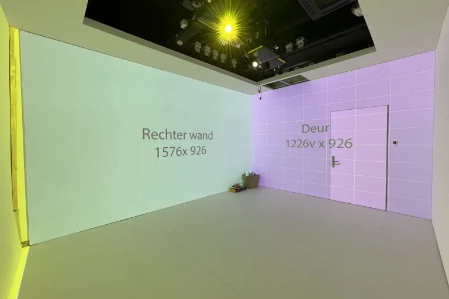

Op basis van die ervaring had ik een experiment gemaakt om te zien of het mogelijk is beelden te creeren in blender. Ik had een bestaande scene gebruikt en een simpele animatie toegevoegd in blender om beelden te kunnen opnemen:

De uitdaging van de immersive lab is dat er 5 wanden zijn waar videos tegelijkertijd afspelen. Echter elke wand speelt een andere video af, en deze videos moeten naadloos op elkaar aansluiten en dat is moeilijk om voor elkaar te krijgen.

Om de aansluiting van de 5 videos te testen had ik de immersive lab in godot nagebouwd. Het doel was om mijn opnames in blender op de wanden af te spelen, en te zien of ze aansloten. Zo kon ik testen zonder de ruimte 500x te moeten inhuren.

Dit was het resultaat toen de sprint was afgelopen:    

Dit was het eindresultaat van sprint 2.

## Video's laten aansluiten: testomgeving bouwen
Zoals te zien is in de vorige afbeelding sloten de videos op de muren van de demo omgeving niet goed aan. Terwijl de scene er leuk uit ziet, is het is geen goede scene om te testen of de opnames goed op elkaar aansluiten.

Om dit sneller en efficienter te kunnen testen wou ik een omgeving bouwen die gespecialiseerd is voor het testen van visuele aansluiting en proporties. Hieronder is te zien hoe de omgeving eruit ziet. Ik heb grid textures op de vloer en muur geplaatst en objecten in de hoeken van de camera's

De testomgeving   
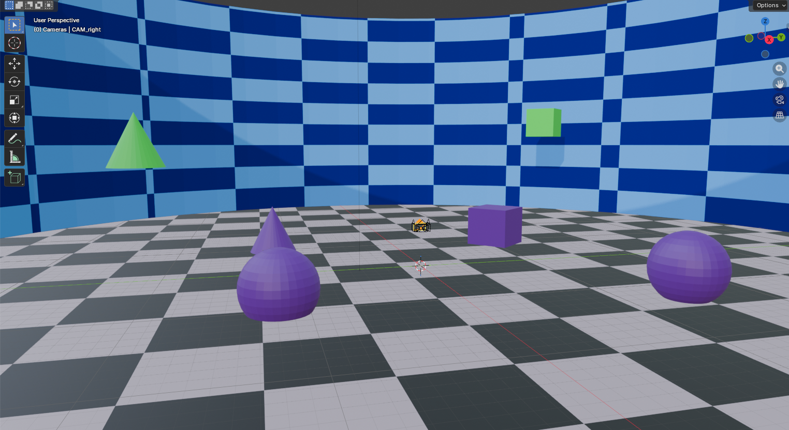

**Waarom deze techniek?**  
In game development wordt vaak gebruik gemaakt van grid textures tijdens het bouwen van omgevingen. Grid textures zijn lelijk, maar worden veel gebruikt om schaal en problemen in oppervlaktes makkelijk te herkennen. Doordat grid texture dezelfde formaat zou moeten zijn, is het makkelijk te zien wanneer iets vervormt is. Dit is perfect om te zien of de videos goed op elkaar aansluiten, en of de proprties van de kort en bredere muren gelijk blijven.

## Blender camera calibratie
De reden dat de videos niet goed op elkaar aansluiten komt omdat mijn camera's niet goed zijn ingesteld. 

### Het probleem
De muren van de immersive lab hebben geen consistente proporties. De voor en achtermuur zijn net niet vierkant. De linker en zij muur zijn rechhoekig en de vloer is ook een rechthoek maar minder breed dan de linker en rechter muur. Voor elke muur is er 1 camera nodig. Met dus uiteindelijk 3 verschillende instellingen, die alsnog exact op elkaar moeten aansluiten. Ik weet exact niks van camera's

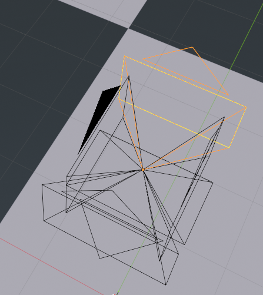

**Belangrijke settings**  
Er 2 belangrijke settings voor de cameras: fov en de resolutie. 

De resolutie is hoe groot de beelden zijn:   
Een standaard monitor heeft een resolutie van 1920x1080 pixels. Dat is hoe breed en hoog het beeld is. In blender kan je ook de resolutie instellen van de camera's. Er zijn 3 verschillende resoluties, en die worden gedictateerd door de immersive room zelf:

1. Voor en achtermuur: 1058 x 799 pixels
2. Linker en rechtermuur: 1358 x 799 pixels
3. Vloer: 1358 x 1058 pixels

De fov is hoeveel je kan binnen die pixels:
Fov staat voor "Field of View", het betekend letterlijk hoeveel je horizontaal of verticaal kan zien. 

Het probleem met blender is, als je settings van de camera instelt, en dan de resolutie veranderd, dan veranderd het hele beeld.. Dus alles kan de juiste settings hebben en tegelijktijd totaal niet aansluiten.

**Originele camera setup**   
Als we mijn originale camera's gebruiken in de testkamer dan is dit het resultaat:    
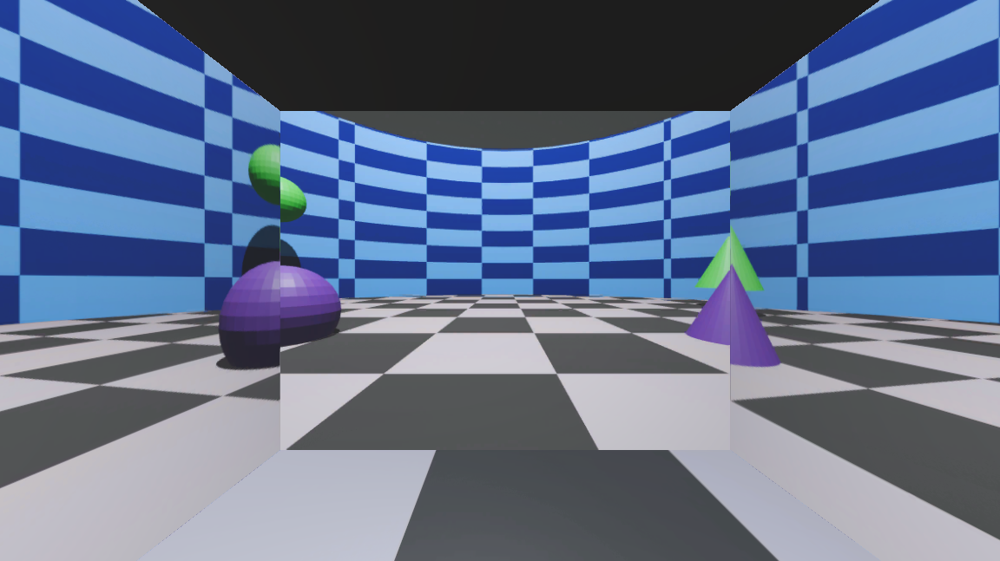

**Experimenteren met camera setup**  
Na 5 pogingen met de settings ben ik hierop uitgekomen

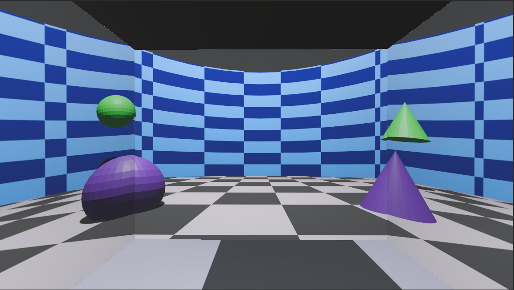

Dit is close, maar nog niet goed eigenlijk. 

**Suspend all logic**    
Ik had al meerdere dingen uitgeprobeerd en was uren bezig. Ik had met AI gekeken of ik de settings goedkreeg en niks werkte. Het beste resultaat wat ik behaalde was poging 5.
 
Ik had een pauze genomen en kwam toen op een idee. Wat als ik geen logica toepast maar gewoon de cameras blijf schalen tot ze perfect aansluiten op de muren van de immersive room...?

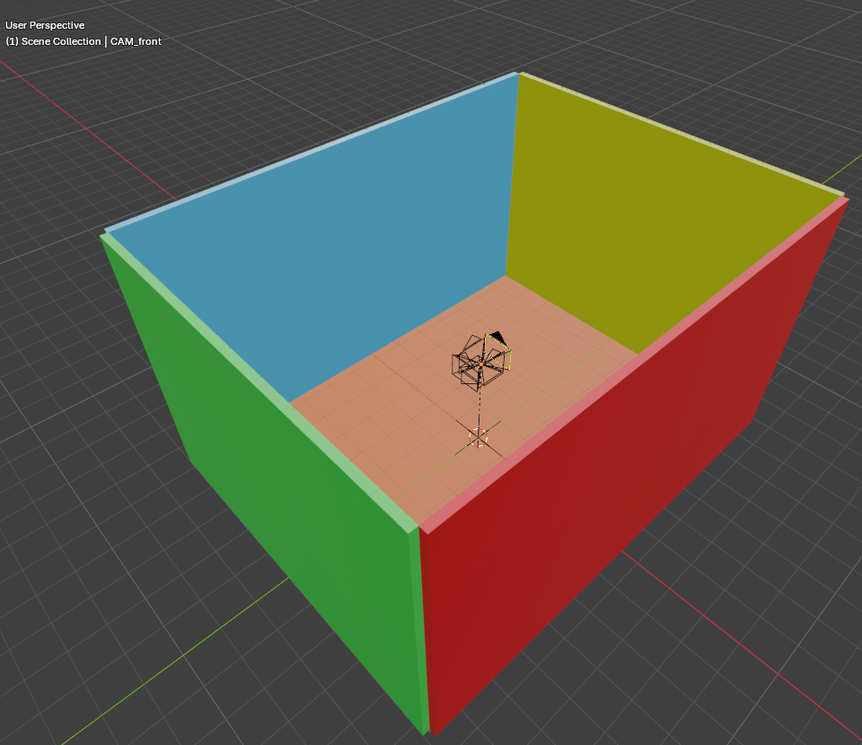

Dit zijn de muren van de immersive room nagemaakt in blender. Het zwarte gedeelte erbinnen zijn de cameras. Ik heb ze geselecteerd en letterlijk gewoon de settings aangepast tot elke muur perfect in beeld kwam.

Succes!  
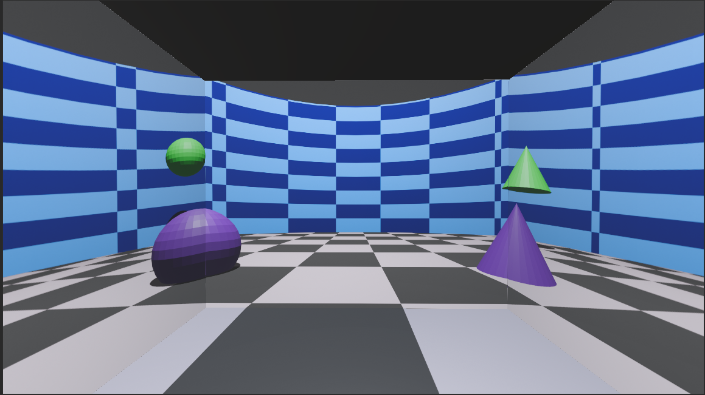

Dit is goed genoeg voor de immersive room. Niet meer aanraken!

**Reflectie / wat ik heb geleerd**  
Tijdens het maken heirvan heb ik wel opgezocht hoe vcameras werken en wat de settings betekenen en doen. Ik heb meerdere keren gezocht naar "How to adjust blender camera for immersive wall", maar uiteraard vind je enkel videos van mensen die het al gedaan hebben maar niet hoe. 

Uiteindelijk was het handig geweest als ik had gezocht naar "How to frame a camera to cover an area perfectly". Dan was ik mogelijk eerder uitgekomen om de camera te schalen naar een digitale versie van de muur in plaats van settings aan te passen. Maar hindsight komt helaas altijd te laat, misschien voor de volgende keer :) 

## Controller
Voor de immersive room is er een template voor waar elke video moet staan zodat het werkt met de beamers in de kamer.

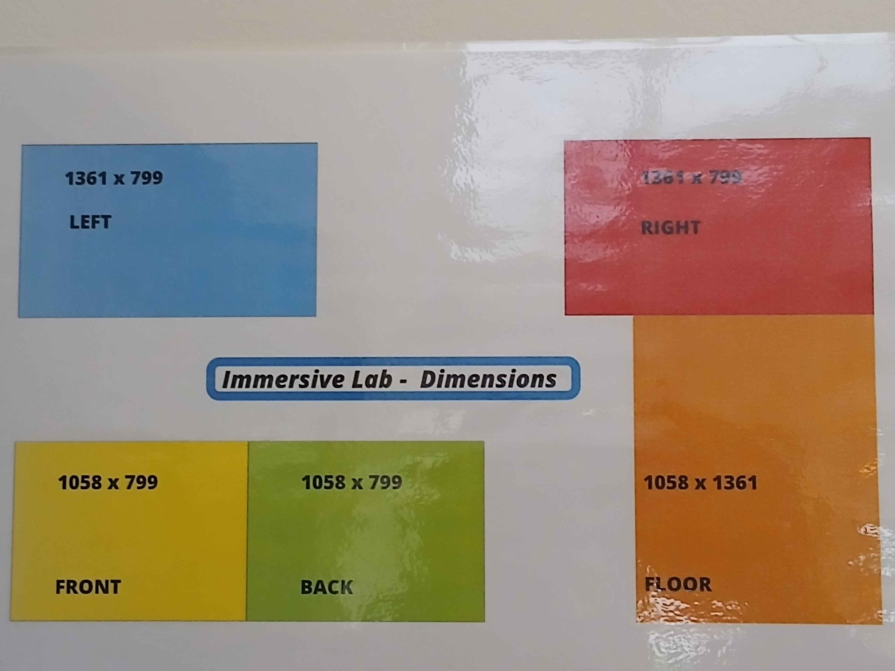

Uiteindelijk heb ik deze pagina's gemaakt   

**Storyline**  
Omdat de gebruiker in een microfoon moet praten, is he tonmogelijk om gewoon een enkele video te hebben die non stop afspeelt. Hierdoor hadden we een systeem nodig dat door middel van code kan stoppen op het moment dat het nodig is, en weer verder kan gaan wanneer de gebruiker input heeft gegeven. Hiervoor heb ik een storyline venster gemaakt. Dit gebruikt een Yaml bestand, dat een verhaallijn heeft en alle videos die nodig zijn.

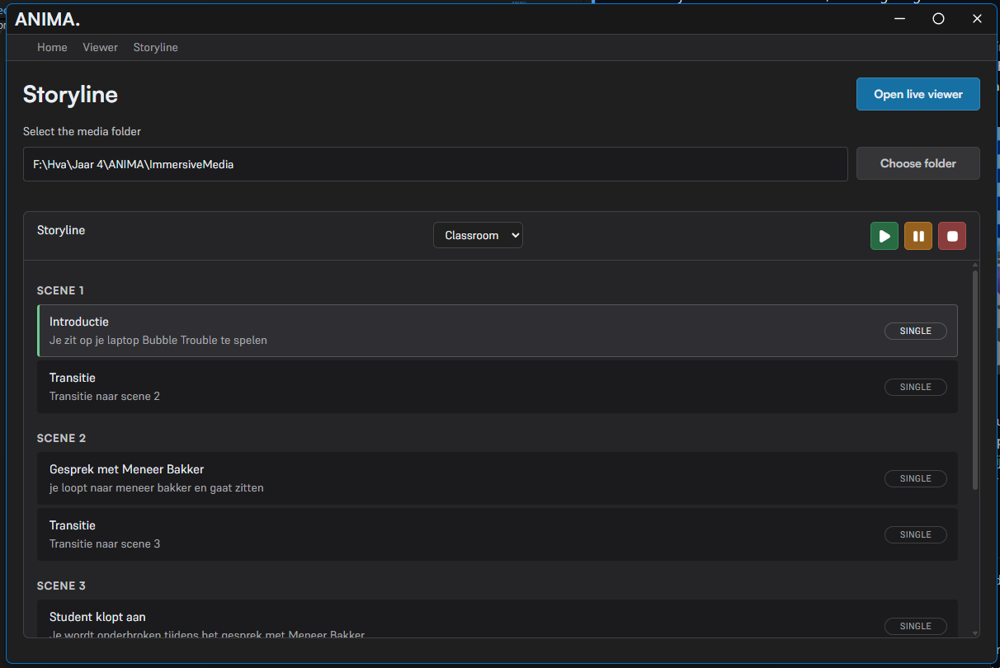

**Edit viewer**  
Van veel medewerkers had ik gehoord dat het niet leuk is om alle muren goed uitgelijnd te krijgen. Dus ik maakte het mijzelf lekker makkelijk en heb gewoon wat code geschreven zodat we live de positie en groote van de muren kunnen aanpassen. Ik had geen zin om telkens heen en weer te moeten gaan enkel om dingen passend te krijgen. Dit was enorm pretig want de template was niet correct voor 4K projectie. Dus toen konden we live gewoon de dimensies aanpassen zodat elke muur netjes bedekt was door onze videos.

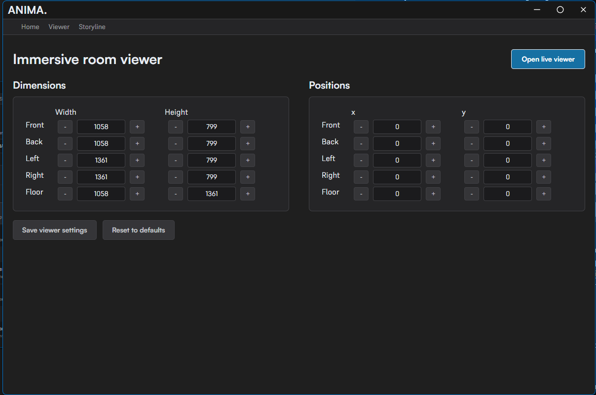

**Viewer**  
Dit is de viewer. Het is een eigen window die de Immersive Lab gebruikt om beelden op elke muur te projecteren. Omdat ik niet wist of we 1080p of 4k zouden draaien (en wat goed werkte) heb ik uiteindelijk ook gewoon gekozen om deze window schalend te maken. Dus hij kan automatisch naar 1080p of 4k schalen, en houd de aspect ratio intact. Dit heeft eigenlijk enorm geholpen want we hebben echt 3 verschillende resoluties uitgeprobeert en het werkte elke keer gewoon goed.

Dus de medewerker van het Lab heeft een template waarbij je de 5 videos op in 1 video kan mergen. Maar wij hebben eigenlijk meerdere lagen nodig. Bijvoorbeeld wij willen een hartslag op 1 van de muren tonen, en dan van muur switchen. Of wij willen een subtitles tonen op 1 van de muren. Hierdoor heb ik gekozen om 5 verschillende areas te maken. En binnen elke area/vlak heb je verschillende lagen. 

Hierdoor is het makkelijk om een overlay bovenop een bestaande video te leggen.

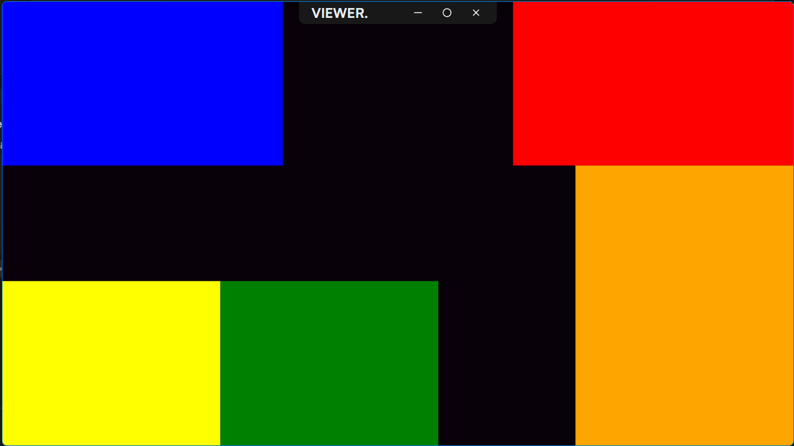

**Waarom heb ik deze keuzes gemaakt**
Als ict'er is het makkelijk om backups te bouwen. Ik vind het efficienter te om een kleine functionaliteit te bouwen waarbij je live kan troubleshooten. Tevens is het project niet super lang en halverwege zijn we pas begonnen bij de immersive lab. Ik wou niet telkens langskomen, oh beelden zijn niet goed, en weer terugkomen. Dankzij al deze dingen is het makkelijk geweest om aanpassingen te maken en daar notities over te maken. 

En de storyline gedeelte was ook gewoon noodzakelijk om het als geheel te laten werken. Deze applicatie wordt de uiteindelijk "brain" van het systeem dat alles gezamelijk kan aansturen. 

## Verhaallijn aanpassen
Voor de immersive room wilt onze opdrachtgever (Barbara, docent Hva) graag 1 uitgewerkte scenario hebben waar je als gebruiker doorheen kan lopen. Een teamgenoot had een scenario verzonnen; mijn taak was om deze scenario visueel na te maken.

Origineel was het verhaallijn voornamelijk 1 lopende gesprek. Ik heb besloten om een gescripte scene te creeren voordat het gesprek begint. Dit gebeurt vooraf elk gesprek en duurt 10 tot 30 seconden, maar het helpt de gebruiker om wat context te krijgen over wat er van hun verwacht wordt.

Bijvoorbeeld meneer bakker wilt met je praten over je opdracht. In het originele idee zit je direct aan tafel met meneer bakker en zelf het gesprek moet starten. Met mijn aanpassingen zie je eerst een simpele video waar je aan je eigen tafel zit. Meneer Bakker roept je naam en vraagt of je even naar hem toe wil komen om over je opdracht te praten. Dan beweegt de camera naar hem en begint hij met een vraag. Dan geeft de gebruiker antwoord en vanaf dat punt kan er een gesprek gestart worden.

**Waarom heb ik dit besluit genomen?**  
Tijdens society 5.0 kwam naar voren dat veel mensen niet helemaal begrepen waar ze over moesten praten met de mentor. Veel mensen vielen stil en het gesprek begon volgens hun te abrubt. Toen we mensen een korte uitleg gaven voordat ze met de mentor praate verliep het veel beter.

Mijn doel was om deze uitleg in te bakken door middel van de verhaallijn. Dit is dan 30 seconden tot 1 minuut wat de gebruiker helpt om context te krijgen van waar ze zijn, wat er gebeurt en wat er van hun verwacht wordt om over te praten.

## Beelden maken voor de verhaallijn
Het verhaallijn was al verzonnen, maar er waren geen specifieke visuele dingen waar de beelden aan moet voldoen.

Omdat onze opdrachtgever van een docent is, heb ik onze klaslokaal nagemaakt. 
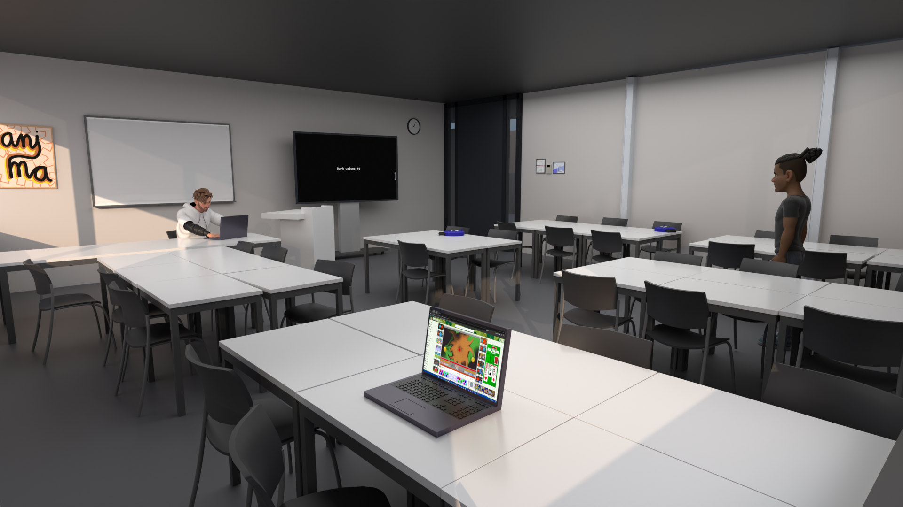

**Modellen**  
Voor de modellen had een teamgenoot al een mannelijke stem met soort van vlaams accent gekozen. Ik wou geen geld uitgeven dus de opties waren gelimiteerd. Uiteindelijk ben ik tot deze model uitgekomen. Ik had er een stuk of 6 getest. Maar omdat de modellen geanimeerd moeten worden, wou ik een model welke een goede rig had zodat ik niet onnodig hoef te lijden. Daarnaast lijkt het alsof deze model "Bakker" zou kunnen heten.

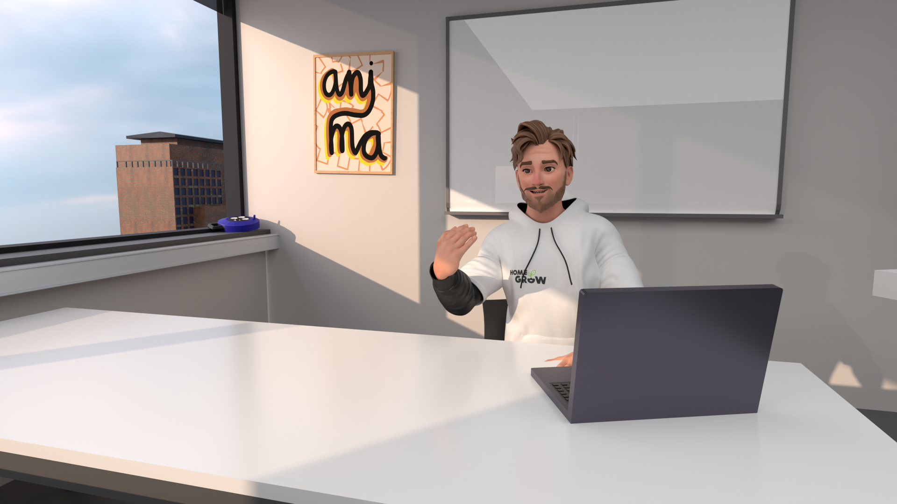

**Waarom heb ik deze keuzes gemaakt?**  
In een eerdere gesprek met de opdrachtgever benoemde ze dat we een aula of klaslokaal konden maken. Ik had de mogelijkheid om online een standaard klaslokaal te vinden, maar de lokalen zager er super cartoony uit. Ik wou graag ook iets wat op een lokaal van de Hva leek, dus ik had besloten om het na te maken. En dit is goed gelukt want 1 van de testers benoemde "je kan echt zien dat dit een Hva lokaal is, best cool".

## Animeren
Dus voor de beelden wou ik graag dat de modellen bewegen. Het is niet super interesant als die enkel op 1 locatie stil zitten.

**Probleem** 
Ik kan niet animeren. Ik heb nog nooit een mens geanimeerd, maar het leek me wel super leuk om te doen.

**Wat ik heb geleerd**  
Animeren is zowel leuk en mentaal martelend hahah. Origineel had ik een normale animatie willen maken. Maar uiteindelijk besloot ik "het is een prototype, het hoeft niet geweldig te zijn" en ben ik neergekomen op een stop motion animatie.

## Mockup maken

**Probleem** 
Ik kan niet animeren. Ik heb nog nooit een mens geanimeerd, maar het leek me wel super leuk om te doen.

## Feedback van het testen
Aan het einde van de sprint heb ik een test gedaan met de opdrachtegever en 2 psychologie studenten. Ik had een lage resolutie versie van de basis verhaallijn gemaakt en een mockup in Davinci resolve van de uiteindelijke UI die over de video heen moet komen zodat hun een concept kunnen hebben van het eindresultaat. 

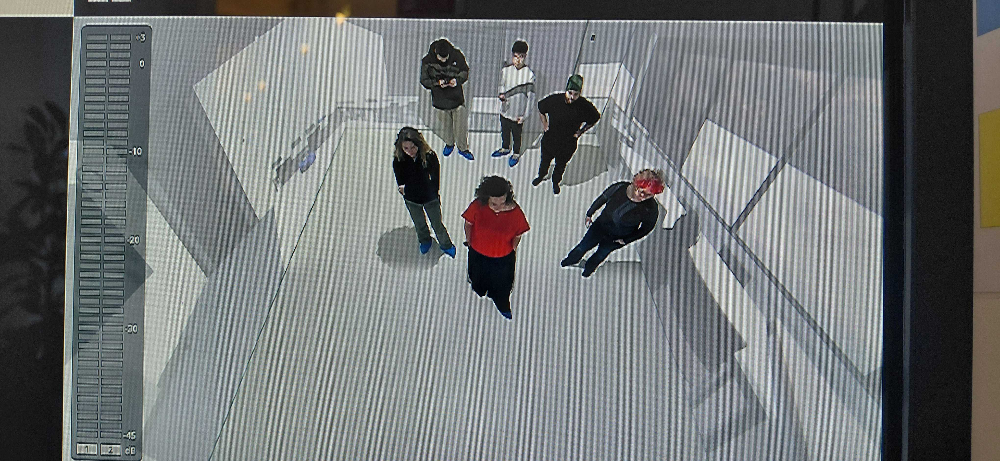

**Beelden Algemeen**  
Ze herkende direct dat de beelden gemaakt waren van een Hva lokaal. De grootste feedback was voornamelijk de plaatsing van de mentor op de rechtermuur. Ik merkte dat grotendeels van de mensen het niet opviel dat de mentor van muur switchte (je moet dan echt 3 meter naar rechts kijken om die te ien). De opdrachtgever gaf het advies om de mentor dan in de andere hoek te zetten zodat die makkelijker te zien is. Dit is een goede tip. Ik moet dan wel de camera positie een beetje aanpassen zodat dingen niet overlappen.

**Verhaallijn aanpassingen**  
Doordat er een kleine introductie was, was het direct voor iedereen duidelijk waar je met de mentor en docent over zou moeten praten. Dat was goed gedaan. Mensen vonden de geluidseffecten etc die ik toegevoegd had ook leuk.

Omdat de mentor gemeen moet worden, had ik een aantal voiceovers gemaakt om te kijken hoe gemeen ik kon zijn en of de opdrachtgever die level wou hebben. Uiteindelijk was ze blij met hoe gemeen de mentor uiteindelijk was. Ik had de docent aardiger gemaakt maar ze wou graag dat de docent net zo gemeen zou worden als de mentor. 

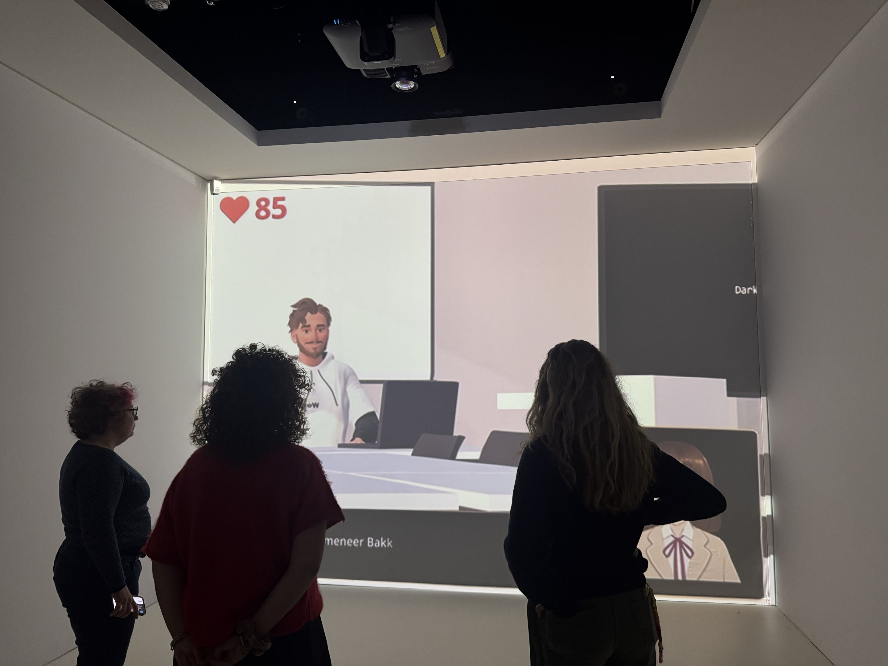

Ook vonden ze het leuk dat ik de interne gedachtes had meegneomen.

**Animatie**  
Een teamgenoot gaf het idee om motion capture te gebruiken voor de karakters. De opdrachtgever en testers zelf hadden niet iets negatiefs te zeggen over de animaties. Dus hun zijn denk ik tevreden.

Ik zou wel graag motion captuire willen gebruiken om te kijken of ik het iets echter' kan laten voelen. Maar het staat onderaan de lijst van alles wat volgende sprint nog gedaan moet worden.

## Reflectie
Deze sprint is goed verlopen, over het algemeen is de opdrachtgever blij met de progressie die we hebben gemaakt. Ze had de dag na de test nog een teams bericht gestuurd om te vragen om de  beelden zodat ze deze met studenten van haar klas kon delen. Dus ik ga ervanuit dat dat een goed teken was.

Ik heb enorm veel geleerd over blender, en geleerd hoeveel meer er is om te leren. 
Ik heb naar mijn gevoel wel wat te veel gedaan. Maar dat is voornamelijk veroorzaakt door mijn eigen ambities, ik had het ook gewoon simpel kunnen houden. Maar dat wou ik niet :)

