# Sprint 3

## Recap
Vorige sprint was het doel om te kijken of het uberhaupt mogelijk is om blender te gebruiken om beelden voor de immersive room te bouwen.

Het antwoord was ja! MAAR... Het was ook "dat is ongelovelijk moeilijk".
Ik had mijn experiment aan de opdrachtgever laten zien, en hun waren eigenlijk best onder de indruk ermee.


## Doel
Voor deze sprint is het belangrijk dat we een visuele omgeving hebben voor de immersive 
room. Vorige sprint heb ik hier een start aan gemaakt, maar dat was enkel een concept. De muren sloten niet goed op elkaar aan waardoor het beeld er niet heel geloofbaar uitziet. 


Aan het einde van dit project willen we 3 omgevingen hebben:
* Een introductie ruimte: hier word de gebruiker uitgelegd wat hun kunnen verwachten van de ervaring. 
* 1 exposure scenario: bijvoorbeeld een klaslokaal, aula, etc etc (dit is de dark gedeelte)
* Een kalmerende omgeving: Na afloop van de exposure ervaring willen we een omgeving hebben wat comfortabel is zodat de gebruiker wat kan ontspannen, terwijl we vragen stellen en feedback kunnen vragen over hun ervaring.

Een master script/programma:  
We hebben veel verschillende technologien die moeten aansluiten en om dat netjes te doen hebben we 1 script nodig die dat kan uitvoeren. Daarvoor wil ik een simpel concept voorbeeld bouwen deze sprint.

# Camera setup..
Doel: cameras goed instellen, zodat alle muren van de immersive room naadloos op elkaar aansluiten.

Probleem?  
Ik heb geen kennis van cameras, behalve dat je op een "opnemen" knopje kan drukken... 


## Betere testomgeving bouwen
Vorige sprint oefende ik met deze omgeving omdat ik iets moois wou tonen:     


Het is mooi maar maakt ook een vreselijke testomgeving.  
Omdat te fixen heb ik deze lelijke eend gebouwd in blender:  

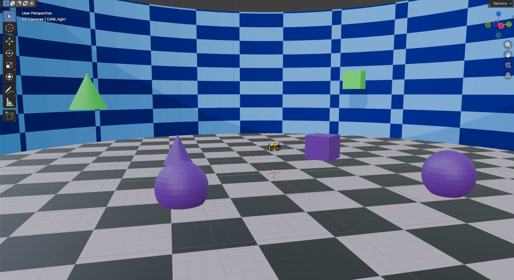

Origineel nam ik videos op en teste in godot om te kijken of de muren netjes overlopen. Maar een video renderen elke keer kost gewoon te veel tijd.

Dus nu heb ik een photobooth in godot! Nu hoef ik maar 1 frame te renderen in blender en dan kan ik direct testen.

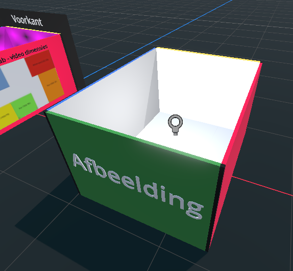

Owja, het was enorm irritant om de afbeelding van elke geneste node in godot aan te passen. Dus ik had een snelle script geschreven zodat de path van de "schermen" in godot gewoon via code gezet worden:

<div style="max-height: 200px; overflow-y: auto;">

```Python
extends Node3D

# IMAGE filepaths
var IMAGE_filepath: Dictionary = {
	"front": "res://media/experimenting/calibration_room/6/front.png",
	"back": "res://media/experimenting/calibration_room/6/back.png",
	"left": "res://media/experimenting/calibration_room/6/left.png",
	"right": "res://media/experimenting/calibration_room/6/right.png",
	"floor": "res://media/experimenting/calibration_room/6/floor.png"
	}

# Video Filepaths
var VIDEO_Filepath: Dictionary = {
	"front": "res://media/dog_scene/3/front.ogv",
	"back": "res://media/dog_scene/3/back.ogv",
	"left": "res://media/dog_scene/3/left.ogv",
	"right": "res://media/dog_scene/3/right.ogv",
	"floor": "res://media/dog_scene/3/floor.ogv",
	}

# Uwu janky code

# Image meshes
@onready var img_mesh_front: MeshInstance3D = $ImageBooth/Front/ImgScreen
@onready var img_mesh_back: MeshInstance3D = $ImageBooth/Back/ImgScreen
@onready var img_mesh_left: MeshInstance3D = $ImageBooth/Left/ImgScreen
@onready var img_mesh_right: MeshInstance3D = $ImageBooth/Right/ImgScreen
@onready var img_mesh_floor: MeshInstance3D = $ImageBooth/Floor/ImgScreen

# VideoStreamPlayers
@onready var vid_front: VideoStreamPlayer = $VideoBooth/Front/VideoScreen/SubViewport/VideoStreamPlayer
@onready var vid_back: VideoStreamPlayer = $VideoBooth/Back/VideoScreen/SubViewport/VideoStreamPlayer
@onready var vid_left: VideoStreamPlayer = $VideoBooth/Left/VideoScreen/SubViewport/VideoStreamPlayer
@onready var vid_right: VideoStreamPlayer = $VideoBooth/Right/VideoScreen/SubViewport/VideoStreamPlayer
@onready var vid_floor: VideoStreamPlayer = $VideoBooth/Floor/ImgScreen/SubViewport/VideoStreamPlayer

func _ready():
	# Set image source
	img_mesh_front.material_override = create_texture_material(IMAGE_filepath["front"])
	img_mesh_back.material_override = create_texture_material(IMAGE_filepath["back"])
	img_mesh_left.material_override = create_texture_material(IMAGE_filepath["left"])
	img_mesh_right.material_override = create_texture_material(IMAGE_filepath["right"])
	img_mesh_floor.material_override = create_texture_material(IMAGE_filepath["floor"])
	
	# Set video source
	vid_front.stream = load(VIDEO_Filepath["front"]) as VideoStream
	vid_back.stream = load(VIDEO_Filepath["back"]) as VideoStream
	vid_left.stream = load(VIDEO_Filepath["left"]) as VideoStream
	vid_right.stream = load(VIDEO_Filepath["right"]) as VideoStream
	vid_floor.stream = load(VIDEO_Filepath["floor"]) as VideoStream
	
	# Play vids
	vid_front.play()
	vid_back.play()
	vid_left.play()
	vid_right.play()
	vid_floor.play()
	
	
# Maketh le new material
func create_texture_material(texture_path: String) -> StandardMaterial3D:
	var matertial := StandardMaterial3D.new()
	matertial.albedo_texture = load(texture_path) as Texture2D
	return matertial
```
</div>

## Testing time!
De opdrachtgever zei dat het extreem moeilijk was om zo'n kamer goed aan te lijnen.    
Dus uiteraard werd ik enkel enthiousiast om die uitdaging aan te gaan.

Probleem om op te lossen:   
Er zijn 3 verschillende resoluties die de immersive room nodig heeft. Maar elke keer wanneer je een andere resolutie toepast, veranderd de formaat van de camera... Dus je moet in camera settings daarvoor compenseren. MAAR HOE?? :(


Note:
Ik hou alle testopzet beschrijvingen en analyses beknopt.


#### Poging 1
Testplan: Zet elke camera op 90 graden en gebruik de benodigde resolutie per camera voor het renderen, en houd je fingers gekruist

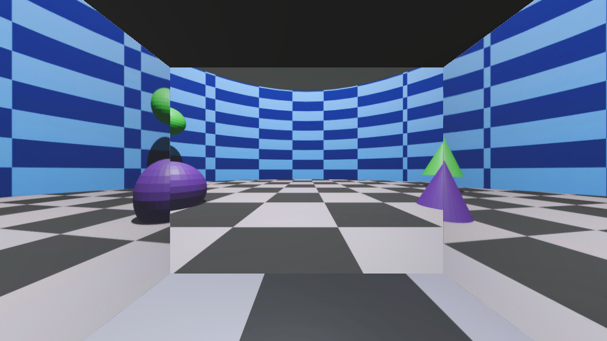

Nope..

#### Poging 2
Testplan: Math... We willen 360 graden zien met 4 cameras. Elke camera heeft zijn eigen breedte. We tellen alle breedtes op, en berekenen hoeveel graden elke camera "mag" zien op basis daarvan


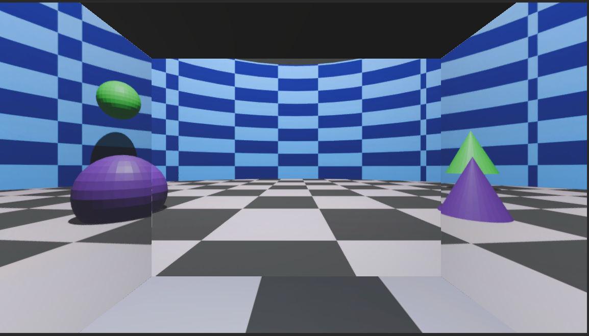

Whoa, beter! Horizontale schaal goed, verticaal niet tho..

#### Poging 3
Testplan: We houden dezelde zichtbare graden zoals in test 2 (FOV), wat als we de resolutie hetzelfde houden, wat gebeurt er dan met de verticale schaal? (heb ik al gezegd niks van camera's af te weten?)

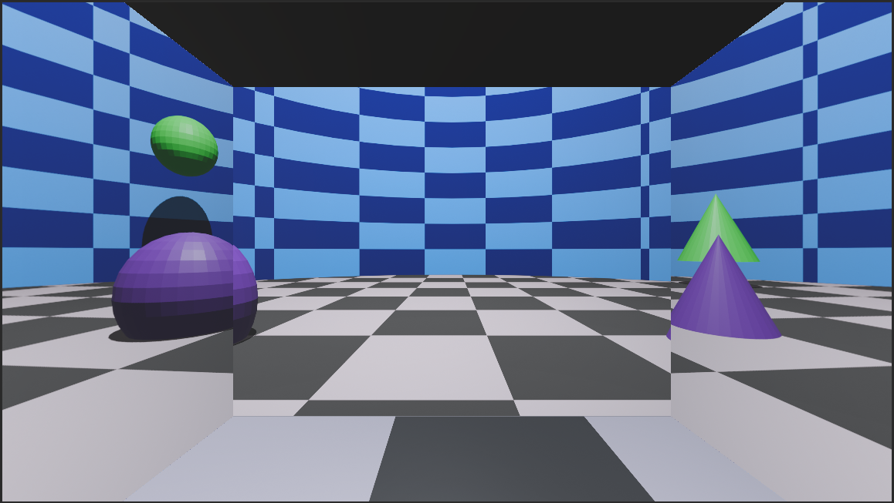

Okay, zag er beter uit met ongelijke resolutie. Dus resolutie heeft er wss niet veel mee te maken.

#### Poging 4
Testplan: Ai... Ik heb AI alle info gegeven over de dimensies, de setup etc etc.

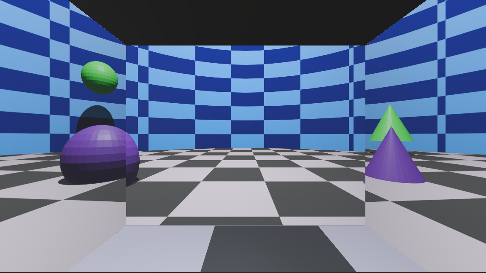

Dit is nagenoeg hetzelfde als mijn vorige poging...

#### Poging 5
Testplan: Ik had eerder de immersive room nagemaakt in blender. Wat als ik... De cameras daarin zet en de settings gewoon blijft schalen totdat de muur perfect in beeld is?...

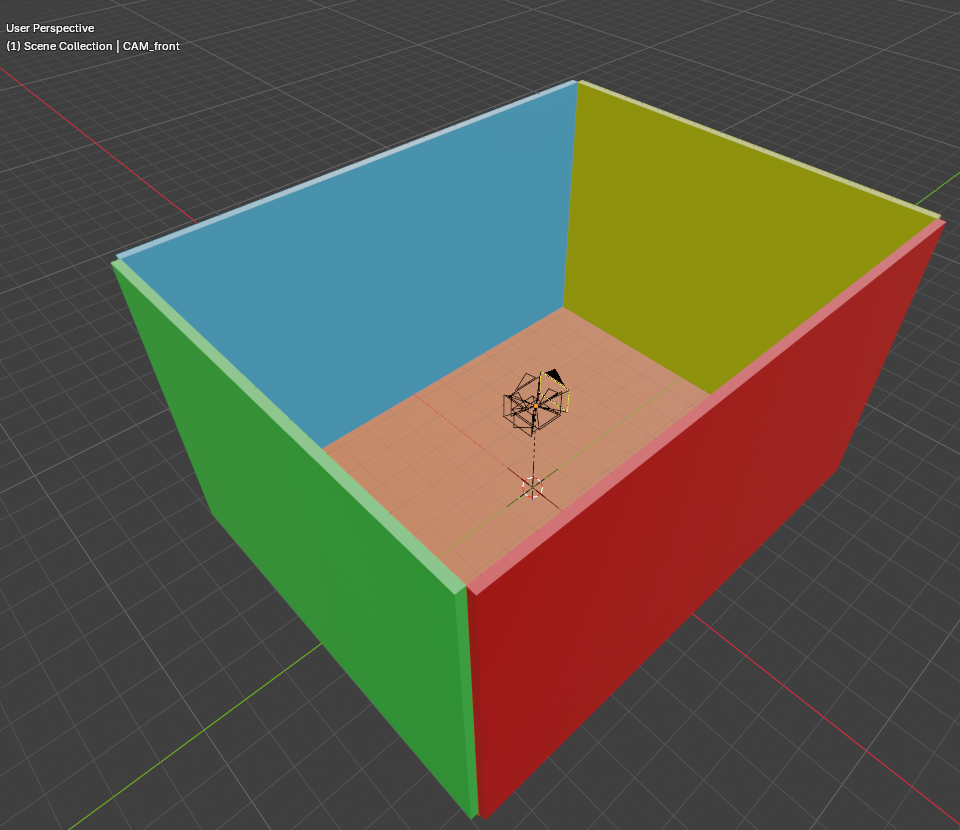


IT WORKEEEEED  
Volgens mij zit de camera voor de vloer verkeerd om...


#### Poging 6
Testplan: zelfde als test 5, maar iets accurater afstellen.

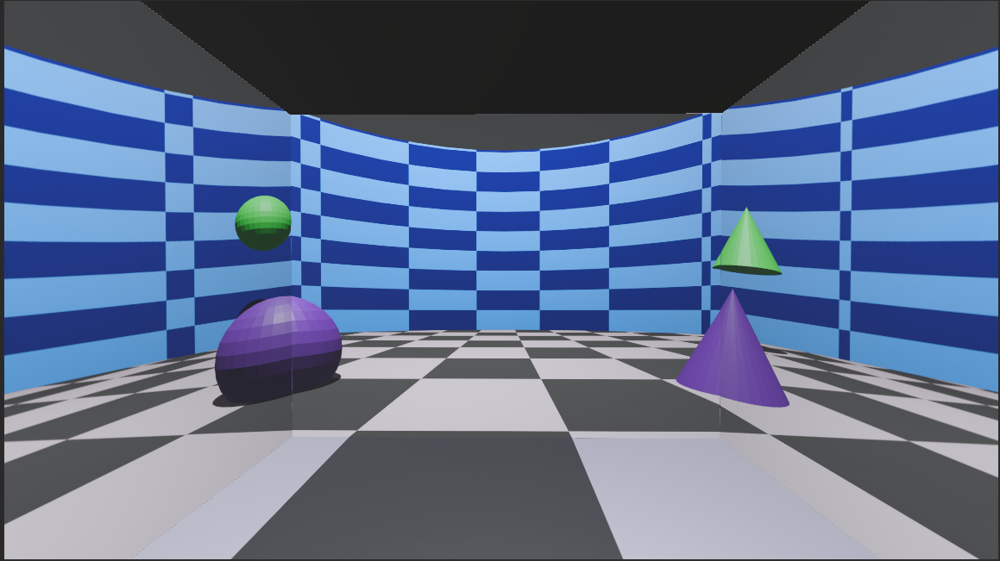

AAAAAAAAAAAAAAAAAAAAAA


In paint lijnen toegevoegd waar de muren in elkaar overlopen:

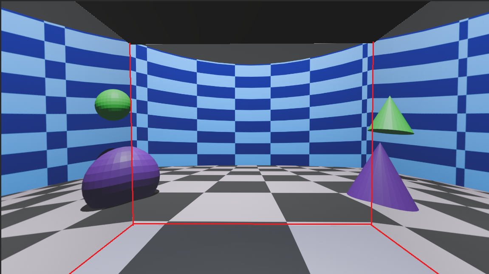

De buitenste muur ziet er een beetje raar uit, de textuur maakt dat extra duidelijk.

Maar ik ben hier blij mee niks meer aan doen.


# Therapie ruimte
Voor de therapie ruimte willen we een omgeving dat kalmerend en vetrouwend is. 


## Kleur psychologie
Als we kijken naar kleur psychologie dan kunnen kleuren impact hebben over hoe we dingen interpreteren. Hieronder een voorbeeld van kleuren en wat deze kunnen opwekken:

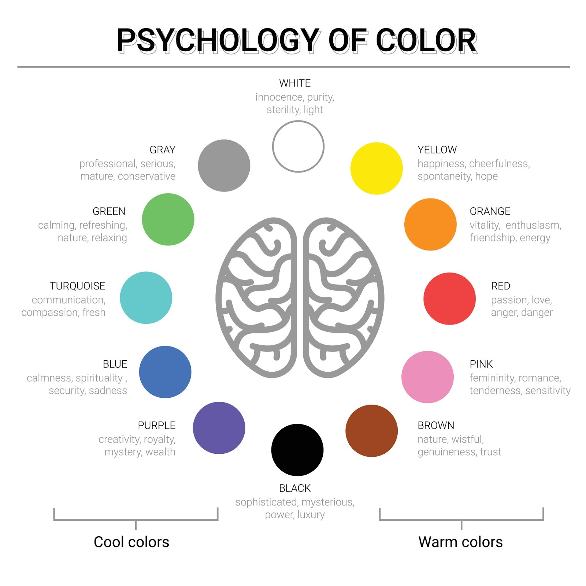

Deze kleuren lijken me interesant
- Brown: nature, wistful, genuineness, trust
- Green: calming, refreshing, nature, relaxing
- Blue: calmness, spirituality, security, sadness

## Shape language

Onze opdrachtgever had het over "shape language" dat in disney gebruikt wordt. Dat is de psychologie van vormen, en hoe vormen onze interpretatie van dingen kunnen beinvloeden.

Source: [Walt disney shape language](https://www.waltdisney.org/sites/default/files/2020-04/T%26T_ShapeLang_v9.pdf) 


Dit staat als voorbeeld in de pdf  
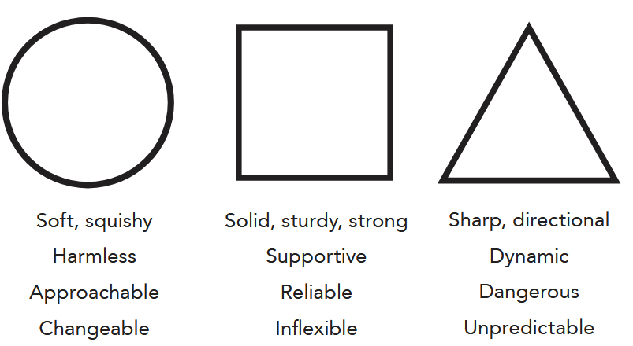

Voor het maken van de therapie ruimte wil ik dus voornamelijk gebruik maken van ronde en vierkante vormen. Zo min mogelijk driehoeken.

## Planten
Er zijn meerdere onderzoeken dat natuur goed voor je kan zijn mentaal. In de buitenlucht zijn, groen om je heen etc. Dus ik wil wat groen in de kamer verwerken.  

https://www.universiteitleiden.nl/nieuws/2025/07/wat-groen-met-je-kan-doen-zelfs-15-minuten-natuur-verbetert-je-mentale-gezondheid

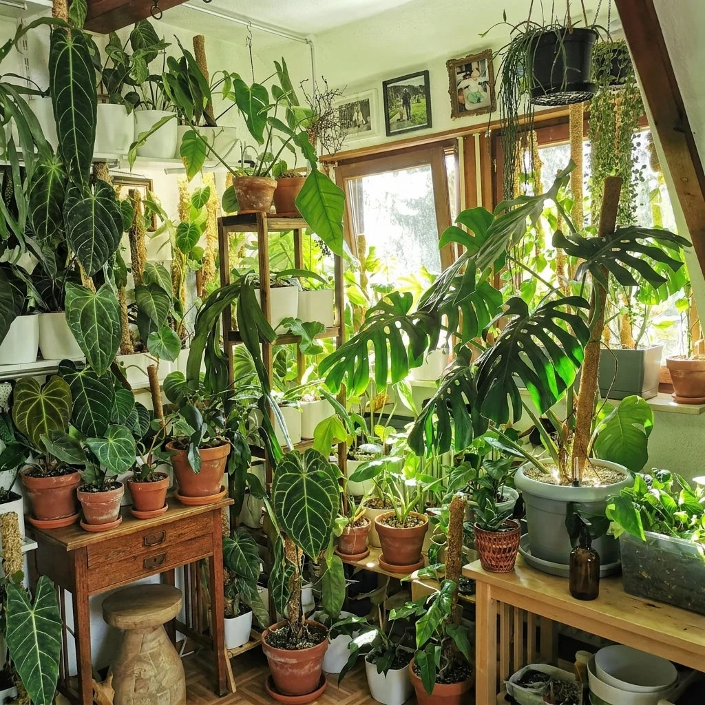


## Verlichting
Verlichting heeft ook impact op hoe iemand zich voeld. Wel eens in het ziekenhuis geweest met de steriele witte kleuren en felle witte verlichting? Dat is "koele" verlichting. Warme verlichting is vaak wat meer geel / oranje.

Voorbeeld:  
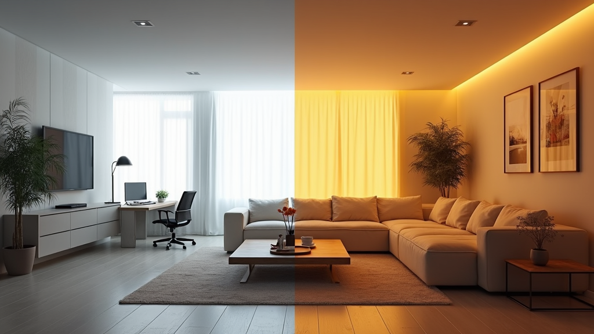

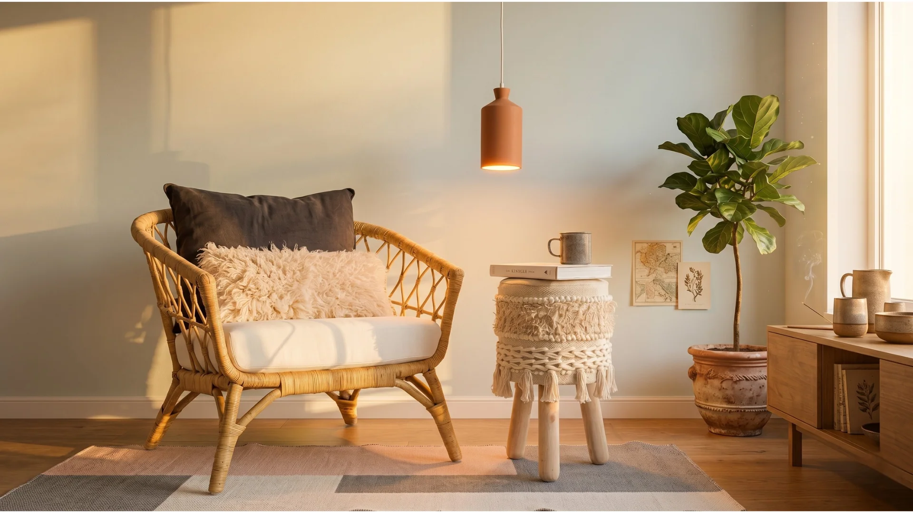


## Textuur
Zachte texturen en variatie zijn vaak essentieel voor een cozy feelinng.
https://www.realsimple.com/three-textures-rule-for-stylish-cozy-home-12186863

Ik denk dat dat genoeg is om richting te geven.

De kamer heeft in ieder geval de volgende objecten nodig:
- 2 stoelen
- Planten (groen)


## Opstelling kamer
Als ik kijk naar afbeeldingen van therapie kamers die veel van de eigenschappen hebben waar ik naar opzoek ben(degene die er niet klinisch uit zien), dan zijn er een paar overlappen in de objecten in de kamer:

Samenvattend:
- 1 stoel therapeut
- 1 bank voor patient
- Kussens op de banken
- Planten van verschillende formaten en op meerdere punten in de kamer
- Meerdere lichtpunten: raam, lampen
- Zachte warme verlichting: geel/oranje gekleurd, geen felle zichtbare lichtpunten.
- Warme muur kleuren: licht beige, of juist mild groene muur
- Knusse kamer: ruimtes zijn compact
- Muurbekleding: Foto frames, houten latten, wandplanken
- Kunst: alle kunst is abstract of natuurfotos
- Zachte texturen: tapijt op de grond, dekentje op de bank
- Tafeltje naast dichtbij bank voor spullen
- Lichtdoorlatende gordijnen
- Veel houtgekleurde meubilair
- Open ruimite of juist kleine tafeltje tussen bank en stoel
- Warmere houten vloer (niet super licht)
- Therapeut stoel staat diagonaal op de bank


[uitwerken]


# Scripting
VOor het project willen we meerdere technieken samen laten werken. Daarvoor hebben we eigenlijk 1 master nodig die alles kan aansturen. Ik heb hier een idee voor en wil hier een prototype voor uitwerken eigenlijk


[uitwerken]


